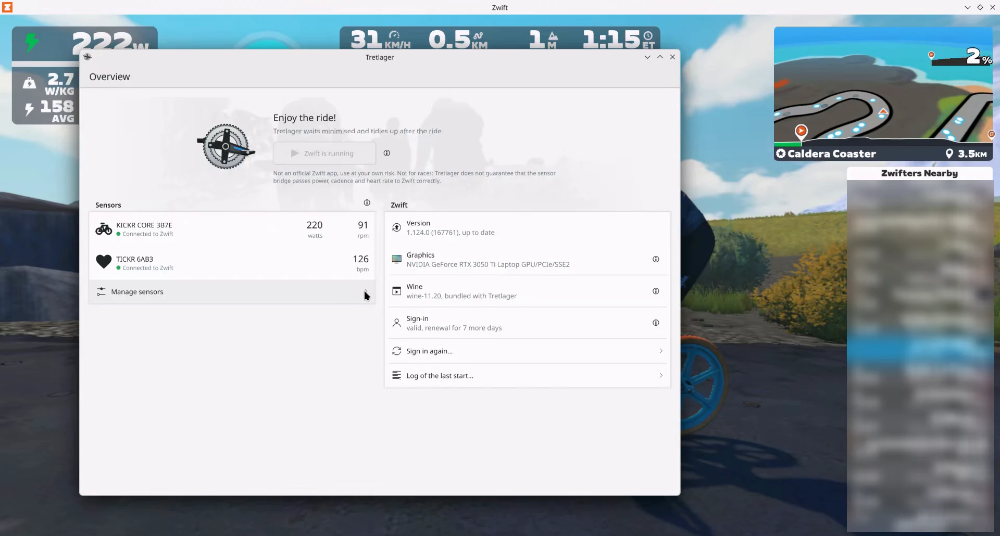
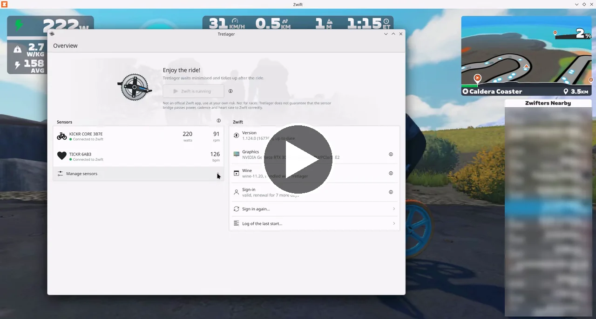
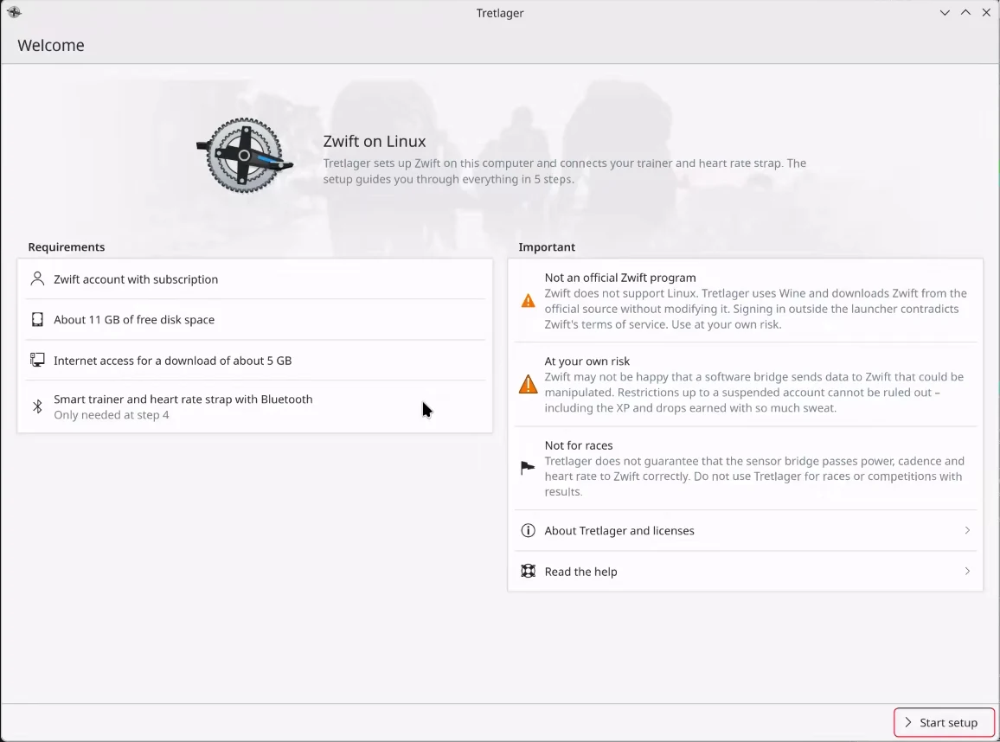
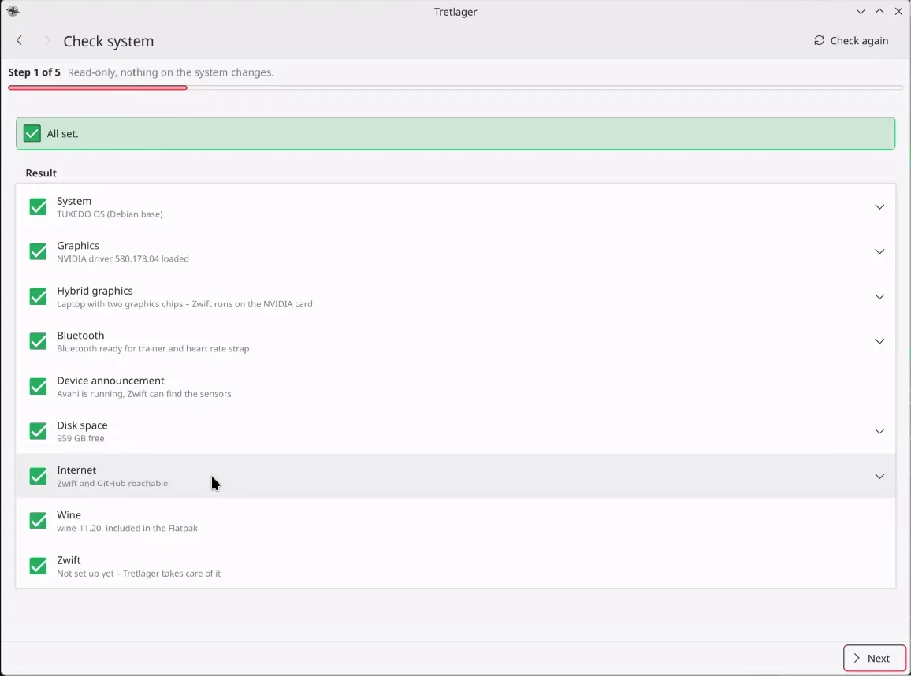
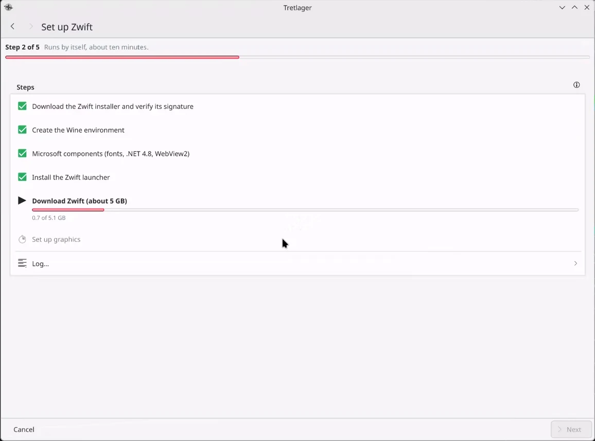
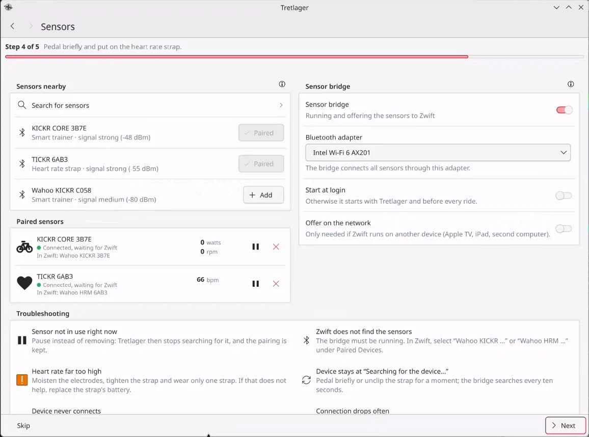
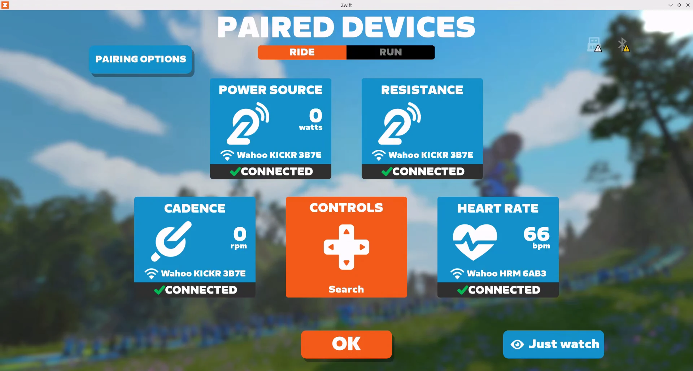
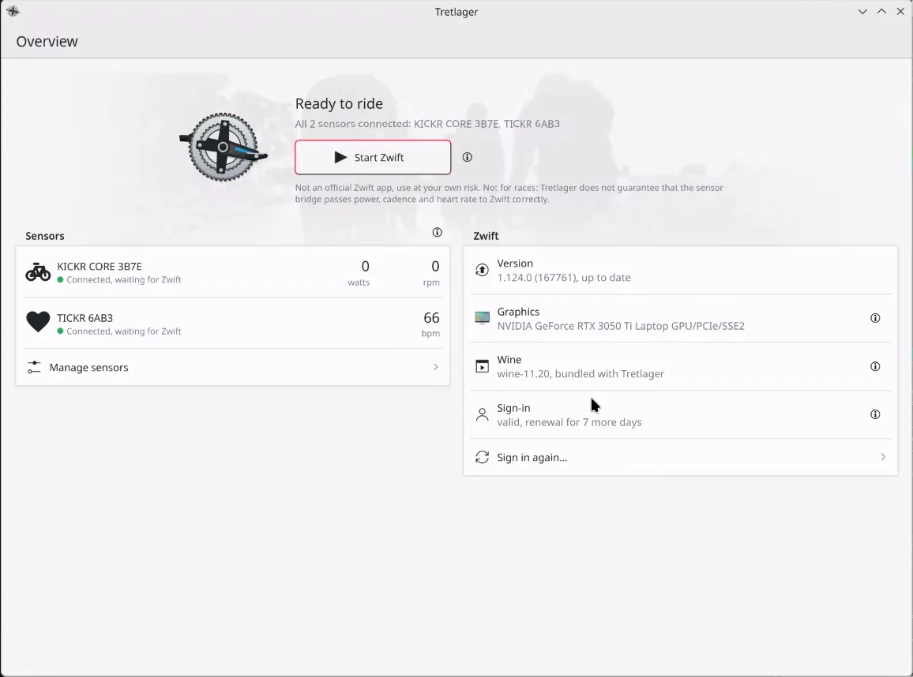
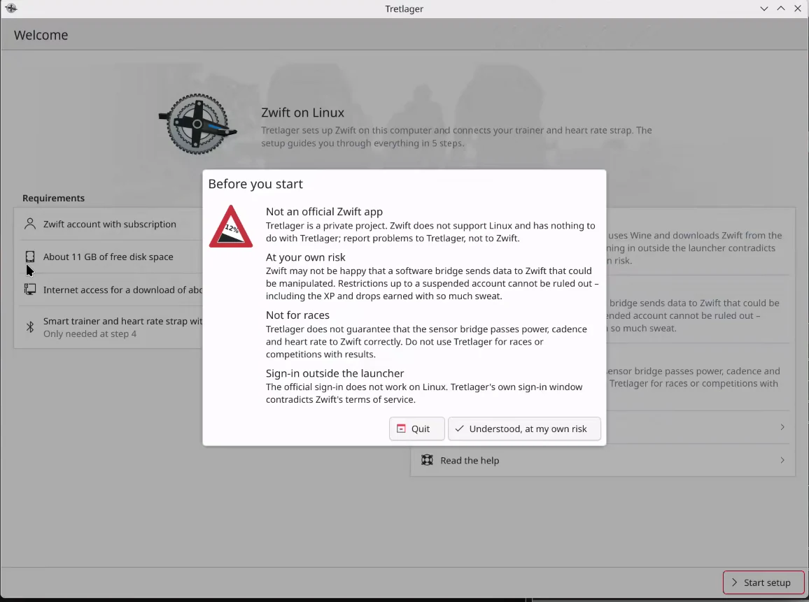

<p align="center">
  
</p>

<h1 align="center">Tretlager</h1>

<p align="center"><strong>Zwift on Linux, set up in five steps.</strong></p>

<p align="center">
  Tretlager installs the official Windows version of Zwift on your Linux computer, signs you in and
  connects your smart trainer and heart rate strap over Bluetooth. No terminal, no Wine tinkering,
  no Companion app on your phone. One button starts the ride.
</p>

<p align="center">
  <a href="https://github.com/linuxundich/tretlager/releases/latest"><strong>Download Flatpak</strong></a>
  &nbsp;·&nbsp; Flathub: not planned &nbsp;·&nbsp;
  <a href="https://linuxundich.de/en/projects/tretlager/">Project page</a>
  &nbsp;·&nbsp;
  <a href="docs/HARDWARE.md">Tested hardware</a>
  &nbsp;·&nbsp;
  <a href="CHANGELOG.md">Changelog</a>
</p>

<p align="center">
  
</p>

> [!WARNING]
> **Not an official Zwift app, use at your own risk.** Tretlager is a private project. Zwift does not
> support Linux and has nothing to do with Tretlager. Zwift may not be happy that a software bridge
> sends data to Zwift that could be manipulated; restrictions up to a suspended account, including
> the XP and drops you earned, cannot be ruled out. **Not for races:** there is no guarantee that
> the bridge passes power, cadence and heart rate to Zwift correctly. The sign-in happens outside
> the Zwift launcher, which contradicts Zwift's terms of service. Tretlager shows these points
> before the first start and only goes on once you accept them.

## See it in action

<a href="docs/tretlager-demo.mp4"></a>

From the first start to the finish line: Tretlager checks the system, installs Wine and Zwift by
itself, signs in, pairs a trainer and a heart rate strap and starts Zwift on the NVIDIA graphics
card. Zwift then finds the sensors through the bridge, and Tretlager keeps watch during the ride.

[**Watch the demo**](docs/tretlager-demo.mp4) (3:43, MP4, 43 MB). The rider data in the video is
simulated, everything else is real.

<br clear="right"/>

## What it does

### A setup assistant instead of a wiki page

Getting Zwift to run under Wine usually means a long list of commands, .NET installers and
registry tweaks. Tretlager turns that into a guided setup. It checks graphics, Bluetooth, disk
space and network first, without changing anything, and tells you what is missing.

<p align="center">
  
  
</p>

### Installs Zwift by itself

Tretlager brings its own Wine and downloads the official Zwift installer straight from Zwift,
verifies its signature and sets up fonts, .NET 4.8 and WebView2. Then the Zwift launcher fetches
the 5 GB game. Tretlager shows the progress and needs about 15 minutes on a normal connection.
Zwift's own files stay untouched.

<p align="center">
  
</p>

### Signs you in

The sign-in page of the Zwift launcher does not work under Wine. Tretlager opens Zwift's own
sign-in page in a private window instead and keeps the session in your desktop's keyring
(KWallet or GNOME Keyring). You type your password into Zwift's page, never into Tretlager. This
step is optional and only happens after you agree.

### Your sensors, without a phone

Wine cannot talk to Bluetooth sensors, and the Zwift Companion app is no fun on Linux. The
Tretlager sensor bridge connects to your smart trainer and heart rate strap over Bluetooth LE and
offers them to Zwift on the same computer, the way a Wahoo trainer with Direct Connect would. In
Zwift you simply pick "Wahoo KICKR …" and "Wahoo HRM …". ERG mode and climbs work, the trainer
gets harder when the road goes up.

<p align="center">
  
</p>

<p align="center">
  
</p>

Pause a sensor you don't need today, pick a USB Bluetooth adapter if the built-in chip is
unreliable, or let the bridge serve Zwift on another device in your network.

### One button to ride

The overview shows your sensors, the Zwift version, the graphics card, Wine and the sign-in at a
glance. "Start Zwift" runs the game on the dedicated NVIDIA card of a hybrid laptop and keeps the screen resolution; on Plasma it also maximises
the window. Tretlager waits in the background, shows live values and tidies
up after the ride. A menu entry "Zwift (Tretlager)" starts the ride directly from the
application launcher.

<p align="center">
  
</p>

### Stays out of trouble

- Before every start Tretlager brings the Zwift environment in line and lets the Zwift launcher
  install game updates.
- A new Wine version comes with a new Tretlager version. The last working one is kept, and a
  switch brings it back if Zwift misbehaves.
- Tretlager warns when the laptop runs on battery or the power supply changes during a ride,
  and when Bluetooth headphones on the bridge's adapter crowd out the sensors.
- While Zwift starts and runs, the screen stays on, also during a break without mouse or keyboard.
- During a Zwift update the overview shows the download progress.
- *Save error report…* writes a ZIP with the logs; tokens, passwords and email addresses are removed.
- Help pages and troubleshooting tips are built in. The interface speaks English and German.

<p align="center">
  
</p>

## How it works

1. Tretlager runs as a Flatpak with its own Wine (built from source, WoW64) and everything else
   Zwift needs. Your system only provides Bluetooth, Avahi and a keyring.
2. Zwift is the unmodified Windows game from Zwift's servers. It renders with OpenGL through
   XWayland, on NVIDIA via PRIME offload.
3. The sensor bridge talks to BlueZ on one side and speaks Wahoo's Direct Connect protocol
   (DIRCON) to Zwift on the other, announced over mDNS on the local machine.

No telemetry, no changed Zwift files, no bypassing of sign-in or licence checks. Network traffic
goes only to Zwift, to GitHub for winetricks and to the download sources of winetricks (Microsoft
fonts, .NET and WebView2) during setup.

The interface uses Kirigami and Kirigami Addons on PySide6, the bridge uses
[Bleak](https://github.com/hbldh/bleak). [qdomyos-zwift](https://github.com/cagnulein/qdomyos-zwift)
served as the reference for the DIRCON protocol.

## Tested hardware

Tretlager is tested on two laptops with one smart trainer and two heart rate straps. Details, versions and
known quirks are in [docs/HARDWARE.md](docs/HARDWARE.md).

| | Main system | Second system |
|---|---|---|
| Computer | TUXEDO InfinityBook Pro Gen7, Intel Core i7-12700H, 32 GB RAM | Dell XPS 15 9560, Intel Core i7-7700HQ, 16 GB RAM |
| Graphics | Intel Iris Xe + NVIDIA GeForce RTX 3050 Ti Laptop (driver 580.178.04) | Intel HD Graphics 630 + NVIDIA GeForce GTX 1050 Mobile (driver 580.196.07) |
| System | TUXEDO OS (Debian forky base), KDE Plasma 6.7 on Wayland | Arch Linux, GNOME 51 on Wayland |
| Bluetooth | Intel AX201, TP-Link UB500 USB adapter | Qualcomm Atheros QCA61x4 |

| Sensor | Connection | Status |
|---|---|---|
| Wahoo KICKR V4 smart trainer | Bluetooth LE (FTMS, Cycling Power) | power, cadence, ERG mode and climbs work |
| Wahoo TICKR heart rate strap | Bluetooth LE (Heart Rate) | works |
| Garmin HRM-Pro Plus heart rate strap | Bluetooth LE (Heart Rate) | works with the Intel AX201 and the TP-Link UB500; ends its connection by itself every 7–15 minutes and reconnects after a few minutes |

Other trainers and straps that use the standard Bluetooth services (FTMS, Cycling Power, Cycling
Speed and Cadence, Heart Rate) should work but are untested. ANT+ is not supported.

## Install

> [!NOTE]
> Tretlager targets current distributions with Flatpak. TUXEDO OS with Plasma is the main
> target, GNOME works. Fedora, Ubuntu and openSUSE are planned but untested; reports are welcome.

Your system needs Flatpak with the Flathub remote, BlueZ with a Bluetooth LE adapter, a running
`avahi-daemon` and a Secret Service keyring (KWallet or GNOME Keyring). Tretlager brings
everything else, including its own Wine.

1. Download `tretlager-<version>-x86_64.flatpak` from the
   [latest release](https://github.com/linuxundich/tretlager/releases/latest).
2. Install it:

```sh
flatpak install --user tretlager-*.flatpak
```

Flatpak fetches the KDE 6.11 runtime from Flathub if it is missing, and on NVIDIA systems the
matching driver extension. Start Tretlager from the application menu and follow the assistant;
setting up Wine and downloading Zwift takes about 15 minutes. Bundles don't update themselves,
so check the Releases page for new versions and install the new bundle the same way.

To remove Tretlager including the Zwift installation (about 10 GB), run
`flatpak uninstall --delete-data de.linuxundich.Tretlager`. Sign out in Tretlager first to remove
the Zwift session from your keyring.

### Build it yourself

```sh
git clone https://github.com/linuxundich/tretlager.git
cd tretlager
build-aux/flatpak/build.sh
```

The first build compiles Wine and takes a while (about 15 minutes on 20 cores).

## More

- [Tested hardware and software](docs/HARDWARE.md) in detail
- [Project page on my blog](https://linuxundich.de/en/projects/tretlager/) · [Changelog](CHANGELOG.md) · [Backlog](BACKLOG.md)
- [Technical notes](docs/technical-notes.md): requirements, everyday use, troubleshooting, development
- Background: [feasibility study](FEASIBILITY.md), [UX concept](docs/ux-concept.md),
  [Flatpak plan](docs/flatpak.md), [updates](docs/updates.md),
  [QA audit](docs/qa-audit-2026-10-30.md)
- Found a bug or tested other hardware? [Open an issue](https://github.com/linuxundich/tretlager/issues)

## On the blog

Tretlager has its own page on my blog
[Linux und Ich](https://linuxundich.de/en/projects/tretlager/), with more
details on the app and news about upcoming versions. The
[project overview](https://linuxundich.de/en/projects/) lists everything else
I build for the Linux desktop. Questions, ideas or feedback that don't fit
into an issue? [Get in touch](https://linuxundich.de/en/contact/), I read
every message.

## Use of AI

Tretlager is AI-assisted. Most of the code, the icon and the translations were written with AI
assistance, directed by me: I set the requirements, made the design decisions, reviewed the
results and tested everything on my own trainer, heart rate straps and laptops. Commits written
with AI assistance carry a `Co-Authored-By` line.

Tretlager is free software under the [GPL-3.0-or-later](LICENSE). It is a personal project,
not affiliated with or endorsed by Zwift, Inc. Zwift is a trademark of Zwift, Inc.; Wahoo, KICKR
and TICKR are trademarks of Wahoo Fitness; Garmin and HRM-Pro are trademarks of Garmin Ltd. Names
of other riders in the screenshots are blurred.
